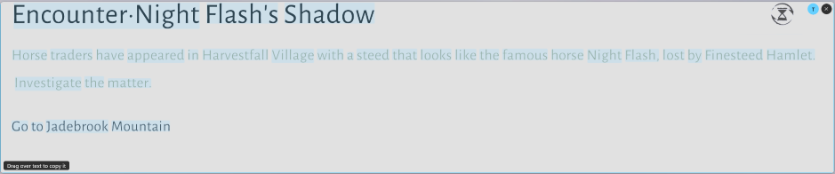
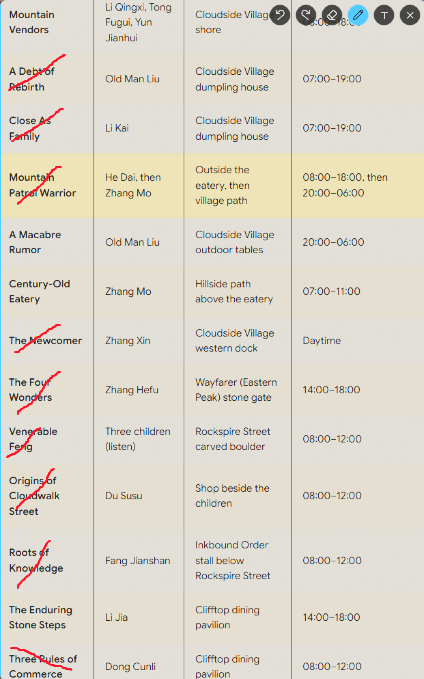
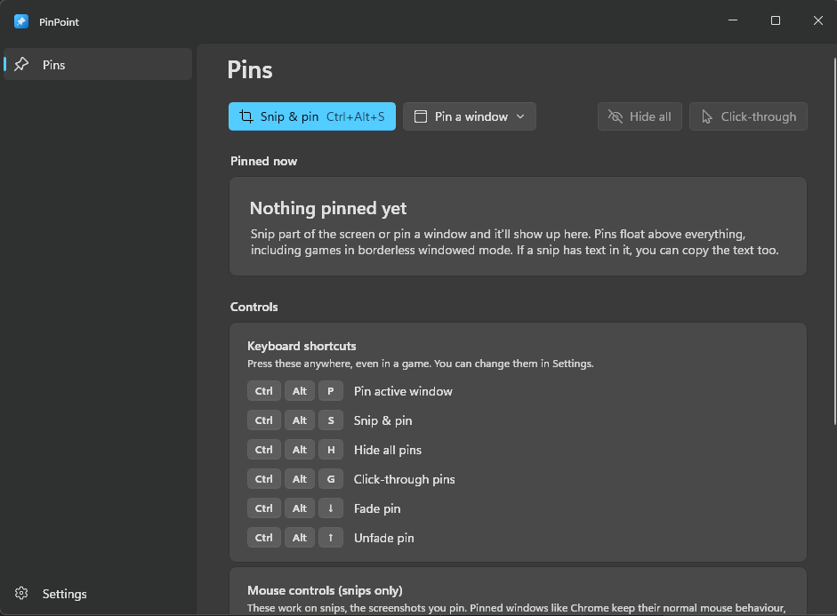
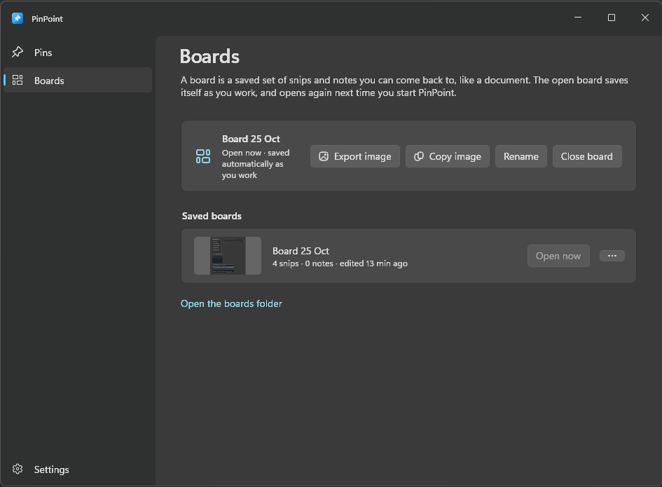

<p align="center">
  
</p>

<h1 align="center">PinPoint</h1>

<p align="center">
  Pin windows, or just the part of the screen you need, on top of everything. Including your game. Copy text off of pinned screenshots, draw on them, pin notes, save it all as boards, and more coming soon.
</p>

<p align="center">
  <a href="https://github.com/MrAliveAgain/PinPoint/releases/latest"></a>
  
  <a href="LICENSE"></a>
</p>

<p align="center">
  
</p>

---

I play on one ultrawide monitor and got tired of alt-tabbing out of games to check a guide. A second monitor would solve it, but I didn't want to use one. Always-on-top tools get you halfway, but most of the time I don't want the whole Chrome window floating over my game. I want the one table or map from the guide, small and off in a corner.

So I made PinPoint. Press a shortcut, drag a box around the bit you care about, and it stays pinned on top while you play. Move it out of the way, shrink it, fade it, and close it when you're done. It pins whole windows too, if that's what you need.

It sits in the tray and doesn't do anything until you press a shortcut.

## What it does

- **Snip & pin.** <kbd>Ctrl</kbd>+<kbd>Alt</kbd>+<kbd>S</kbd> freezes the screen. Drag a box, or click a window to grab all of it, and that piece stays on top right where it was. It's also saved as a PNG and copied to your clipboard.
- **Pin any window.** <kbd>Ctrl</kbd>+<kbd>Alt</kbd>+<kbd>P</kbd> keeps the window you're in above everything else, with a coloured border so you can tell which one it is. Press it again to unpin.
- **Grab text out of snips.** If a snip has text in it, a small **T** button appears when you hover. Click it, drag over the words you want, and they're copied when you let go. Tables keep their rows and columns when you paste them. It uses the text recognition built into Windows, so it all happens on your PC. You can also right-click a snip → **Copy text** to grab all of it at once.

  

- **Mark up snips.** Click the pen on a snip and draw on it in red: circle the bit that matters, cross off what you've done. Right-drag erases a line, and undo, redo and erase-all sit right next to the pen. Lines stay on what they mark when you zoom.

  

- **Scratch-pad notes.** <kbd>Ctrl</kbd>+<kbd>Alt</kbd>+<kbd>N</kbd> opens a little note that floats on top, for jotting down a quest step, a code, or text you copied from a snip. Drag it by its header and resize it from the edges. It saves as you type and comes back where you left it after a restart. Want it as a proper file? Hit the save button or <kbd>Ctrl</kbd>+<kbd>S</kbd> to save it as a `.txt` wherever you like, just like Notepad (after the first save, <kbd>Ctrl</kbd>+<kbd>S</kbd> saves straight back to that file; <kbd>Ctrl</kbd>+<kbd>Shift</kbd>+<kbd>S</kbd> picks a new one).
- **Boards.** Save the snips and notes you've got up as a board and pick up where you left off later, like a document. Export or copy a board as one picture, too. [More below](#boards).
- **Pin any image.** Copied a picture from a website, or have a screenshot on the clipboard? <kbd>Ctrl</kbd>+<kbd>Alt</kbd>+<kbd>I</kbd> pins it like a snip. You can also drop image files onto the PinPoint window.
- **Stays over games.** Anything in borderless or windowed mode. If a game puts itself back on top, PinPoint puts your pins back over it.
- **Easy to get out of the way.** Hide every pin at once, fade them, or make them click-through so your clicks go straight to the game.
- **Small and quick.** No installer, no account, no internet connection. Just an exe in a folder.

<p align="center">
  
</p>

## Download

1. Grab the latest `.zip` from **[Releases](https://github.com/MrAliveAgain/PinPoint/releases/latest)**.
2. Right-click the zip → **Extract All**, and put the folder wherever you like. (Don't run it from inside the zip; it needs the files next to it.)
3. Run `PinPoint.exe` from the extracted folder. It shows up in the system tray.

Needs Windows 11 (64-bit). Everything else it needs is already in the folder.

> **Heads up:** the exe isn't code-signed (certificates cost a lot for a hobby project), so the first time you run it Windows SmartScreen may say *"Windows protected your PC"*. Click **More info > Run anyway**. All the source is right here if you'd rather build it yourself.

If you want it to start with Windows, there's a toggle in Settings. It's off by default.

## Shortcuts

All of these can be changed in Settings.

| Shortcut | What it does |
|---|---|
| <kbd>Ctrl</kbd>+<kbd>Alt</kbd>+<kbd>S</kbd> | Snip a part of the screen and pin it |
| <kbd>Ctrl</kbd>+<kbd>Alt</kbd>+<kbd>P</kbd> | Pin / unpin the window you're in |
| <kbd>Ctrl</kbd>+<kbd>Alt</kbd>+<kbd>N</kbd> | New note |
| <kbd>Ctrl</kbd>+<kbd>Alt</kbd>+<kbd>I</kbd> | Pin the image you copied |
| <kbd>Ctrl</kbd>+<kbd>Alt</kbd>+<kbd>H</kbd> | Hide / show all pins |
| <kbd>Ctrl</kbd>+<kbd>Alt</kbd>+<kbd>G</kbd> | Click-through on / off |
| <kbd>Ctrl</kbd>+<kbd>Alt</kbd>+<kbd>↓</kbd> / <kbd>↑</kbd> | Fade / unfade the pin under your mouse |

## Moving snips around

These mouse controls are for snips (the screenshots you pin). Pinned windows like Chrome keep their normal mouse behaviour; fade those with <kbd>Ctrl</kbd>+<kbd>Alt</kbd>+<kbd>↓</kbd> / <kbd>↑</kbd> instead.

| | |
|---|---|
| Move | Drag it |
| Resize | Scroll |
| Fade | Hold right-click and scroll |
| Back to original size | Double-click |
| Close | Middle-click or <kbd>Esc</kbd> |
| Copy text | Click the **T** button (shows on hover), then drag over the words. Click **T** again to go back to moving the snip. |
| Draw / erase | Click the **pen** button (shows on hover), then drag to draw. Right-drag over a line to erase it. Undo, redo and erase-all appear next to the pen. Click the pen again to go back to moving the snip. |
| Copy image or all text, save as, opacity, click-through | Right-click |
| Lock it in place (no accidental moving or resizing) | Right-click → **Lock in place** |

You can snip from a pinned window or from another snip too. It works the same as snipping anything else.

## Boards

A board saves your pinned snips and notes exactly as you left them, so you can open them again later. I keep one board per game, plus a few for projects.

- **Save and switch.** On the **Boards** page, *Save as board…* keeps what's on screen, and the open board saves itself as you work. Opening another board swaps your pins over; if what's up isn't in a board yet, PinPoint asks first. The tray menu has your boards too, so you can switch without leaving a game.
- **Picks up where you left off.** The board you had open comes back when you start PinPoint. Snips that aren't in any board come back as well.
- **Quick look.** Click a board's thumbnail to see what's on it without opening it. Hover a pin to see it full size, or right-click it to copy or save just that one.
- **Export or copy as one picture.** Pick which pins go in (click to tick them), keep the on-screen layout or pack them together, and choose a background: a solid colour, a dot grid, transparent, or any picture of your own, stretched or tiled. You see the finished picture before saving it. Copy skips the questions and puts it straight on your clipboard.
- **Pinned windows in the picture.** If you've got windows pinned, a snapshot of them can go in the picture too. Only the picture, though; a board never includes pinned windows.
- **Deleting** a board sends it to the Recycle Bin, so a slip isn't the end of it.

<p align="center">
  
</p>

## Good to know

- **Exclusive fullscreen games** can't be drawn over by anything. Switch them to borderless windowed.
- **Windows running as administrator** (often games with anti-cheat) can only be pinned if PinPoint runs as admin too.

## What it touches on your PC

- Settings and logs: `%LocalAppData%\PinPoint`
- Saved snips: `Pictures\PinPoint` (you can change this)
- Boards: `%LocalAppData%\PinPoint\boards`, one folder per board (a `board.json`, each snip's image and a small preview). Snips that aren't in a board are kept the same way in `%LocalAppData%\PinPoint\session` until you close them.
- Notes: `%LocalAppData%\PinPoint\notes`, one plain `.txt` file per note. When you close a note that has text in it, it's moved to `notes\closed` rather than deleted, in case you closed it by accident.
- Start with Windows, only if you turn it on: one entry under `HKCU\Software\Microsoft\Windows\CurrentVersion\Run`

Pinned windows go back exactly how they were when you unpin them or quit. PinPoint never connects to the internet and doesn't collect anything.

**Uninstalling:** quit it from the tray and delete the folder. Delete `%LocalAppData%\PinPoint` too if you want your settings, notes and boards gone.

## Building it yourself

You'll need the .NET 10 SDK on Windows 11.

```bash
dotnet build src/PinPoint.App
```

[docs/DEVELOPMENT.md](docs/DEVELOPMENT.md) covers tests, release builds and how the code is laid out.

## Feedback

Found a bug or got an idea? [Open an issue](https://github.com/MrAliveAgain/PinPoint/issues). I'm always curious what games people are using it with, too.

## License

[MIT](LICENSE)
