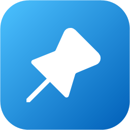

<p align="center">
  
</p>

<h1 align="center">PinPoint</h1>

<p align="center">
  Pin windows, or just the part of the screen you need, on top of everything. Including your game.
</p>

<p align="center">
  <a href="https://github.com/MrAliveAgain/PinPoint/releases/latest"></a>
  
  <a href="LICENSE"></a>
</p>

<p align="center">
  
</p>

---

I play on one ultrawide monitor and got tired of alt-tabbing out of games to check a guide. A second monitor would solve it, but I didn't want to use one. Always-on-top tools get you halfway, but most of the time I don't want the whole Chrome window floating over my game. I want the one table or map from the guide, small and off in a corner.

So I made PinPoint. Press a shortcut, drag a box around the bit you care about, and it stays pinned on top while you play. Move it out of the way, shrink it, fade it, and close it when you're done. It pins whole windows too, if that's what you need.

It sits in the tray and doesn't do anything until you press a shortcut.

## What it does

- **Snip & pin.** <kbd>Ctrl</kbd>+<kbd>Alt</kbd>+<kbd>S</kbd> freezes the screen. Drag a box, or click a window to grab all of it, and that piece stays on top right where it was. It's also saved as a PNG and copied to your clipboard.
- **Pin any window.** <kbd>Ctrl</kbd>+<kbd>Alt</kbd>+<kbd>P</kbd> keeps the window you're in above everything else, with a coloured border so you can tell which one it is. Press it again to unpin.
- **Stays over games.** Anything in borderless or windowed mode. If a game puts itself back on top, PinPoint puts your pins back over it.
- **Easy to get out of the way.** Hide every pin at once, fade them, or make them click-through so your clicks go straight to the game.
- **Small and quick.** No installer, no account, no internet connection. Just an exe in a folder.

## Download

1. Grab the latest `.zip` from **[Releases](https://github.com/MrAliveAgain/PinPoint/releases/latest)**.
2. Right-click the zip → **Extract All**, and put the folder wherever you like. (Don't run it from inside the zip; it needs the files next to it.)
3. Run `PinPoint.exe` from the extracted folder. It shows up in the system tray.

Needs Windows 11 (64-bit). Everything else it needs is already in the folder.

> **Heads up:** the exe isn't code-signed (certificates cost a lot for a hobby project), so the first time you run it Windows SmartScreen may say *"Windows protected your PC"*. Click **More info > Run anyway**. All the source is right here if you'd rather build it yourself.

If you want it to start with Windows, there's a toggle in Settings. It's off by default.

## Shortcuts

All of these can be changed in Settings.

| Shortcut | What it does |
|---|---|
| <kbd>Ctrl</kbd>+<kbd>Alt</kbd>+<kbd>S</kbd> | Snip a part of the screen and pin it |
| <kbd>Ctrl</kbd>+<kbd>Alt</kbd>+<kbd>P</kbd> | Pin / unpin the window you're in |
| <kbd>Ctrl</kbd>+<kbd>Alt</kbd>+<kbd>H</kbd> | Hide / show all pins |
| <kbd>Ctrl</kbd>+<kbd>Alt</kbd>+<kbd>G</kbd> | Click-through on / off |
| <kbd>Ctrl</kbd>+<kbd>Alt</kbd>+<kbd>↓</kbd> / <kbd>↑</kbd> | Fade / unfade the pin under your mouse |

## Moving snips around

| | |
|---|---|
| Move | Drag it |
| Resize | Scroll |
| Fade | <kbd>Alt</kbd> + scroll, or hold right-click and scroll |
| Back to original size | Double-click |
| Close | Middle-click or <kbd>Esc</kbd> |
| Copy, save as, opacity, click-through | Right-click |

You can snip from a pinned window or from another snip too. It works the same as snipping anything else.

## Good to know

- **Exclusive fullscreen games** can't be drawn over by anything. Switch them to borderless windowed.
- **Games that run as administrator** (often ones with anti-cheat) stop normal apps from seeing held keys, so <kbd>Alt</kbd> + scroll may not fade a snip while that game has focus. Right-click + scroll and the fade shortcuts still work. To pin a window that's running as admin, run PinPoint as admin too.

## What it touches on your PC

- Settings and logs: `%LocalAppData%\PinPoint`
- Saved snips: `Pictures\PinPoint` (you can change this)
- Start with Windows, only if you turn it on: one entry under `HKCU\Software\Microsoft\Windows\CurrentVersion\Run`

Pinned windows go back exactly how they were when you unpin them or quit. PinPoint never connects to the internet and doesn't collect anything.

**Uninstalling:** quit it from the tray and delete the folder. Delete `%LocalAppData%\PinPoint` too if you want your settings gone.

## Building it yourself

You'll need the .NET 10 SDK on Windows 11.

```bash
dotnet build src/PinPoint.App
```

[docs/DEVELOPMENT.md](docs/DEVELOPMENT.md) covers tests, release builds and how the code is laid out.

## Feedback

Found a bug or got an idea? [Open an issue](https://github.com/MrAliveAgain/PinPoint/issues). I'm always curious what games people are using it with, too.

## License

[MIT](LICENSE)
